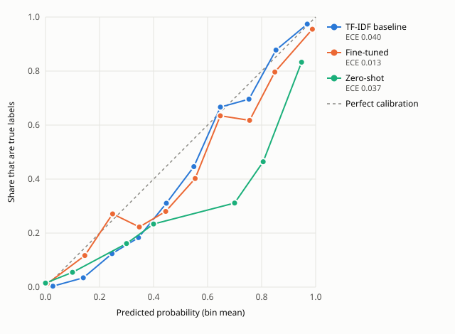

# Reliability, test split

Every (case, series) probability pooled over series, binned by predicted probability; descriptive, drawn from the stored test predictions after the frozen run. Bins under 20 points are left off the plot.

| Model | ECE |
| --- | --- |
| TF-IDF baseline | 0.040 |
| Fine-tuned | 0.013 |
| Zero-shot | 0.037 |

| bin     |   ('points', 'baseline') |   ('points', 'finetune') |   ('points', 'zeroshot') |   ('mean_predicted', 'baseline') |   ('mean_predicted', 'finetune') |   ('mean_predicted', 'zeroshot') |   ('observed', 'baseline') |   ('observed', 'finetune') |   ('observed', 'zeroshot') |
|:--------|-------------------------:|-------------------------:|-------------------------:|---------------------------------:|---------------------------------:|---------------------------------:|---------------------------:|---------------------------:|---------------------------:|
| 0.0-0.1 |                    12527 |                    14685 |                    14360 |                            0.027 |                            0.006 |                            0     |                      0.004 |                      0.012 |                      0.015 |
| 0.1-0.2 |                     1652 |                      351 |                      584 |                            0.14  |                            0.146 |                            0.1   |                      0.035 |                      0.117 |                      0.055 |
| 0.2-0.3 |                      646 |                      203 |                        7 |                            0.246 |                            0.248 |                            0.2   |                      0.124 |                      0.271 |                      0     |
| 0.3-0.4 |                      393 |                      211 |                       31 |                            0.344 |                            0.347 |                            0.3   |                      0.183 |                      0.223 |                      0.161 |
| 0.4-0.5 |                      235 |                      107 |                      107 |                            0.447 |                            0.445 |                            0.4   |                      0.311 |                      0.28  |                      0.234 |
| 0.5-0.6 |                      195 |                       97 |                        7 |                            0.549 |                            0.554 |                            0.5   |                      0.446 |                      0.402 |                      0.286 |
| 0.6-0.7 |                      177 |                       93 |                       11 |                            0.647 |                            0.647 |                            0.6   |                      0.667 |                      0.634 |                      0.182 |
| 0.7-0.8 |                      181 |                       81 |                      106 |                            0.753 |                            0.756 |                            0.7   |                      0.696 |                      0.617 |                      0.311 |
| 0.8-0.9 |                      254 |                      118 |                      489 |                            0.853 |                            0.849 |                            0.806 |                      0.878 |                      0.797 |                      0.464 |
| 0.9-1.0 |                      885 |                     1199 |                     1443 |                            0.969 |                            0.988 |                            0.948 |                      0.974 |                      0.955 |                      0.833 |
